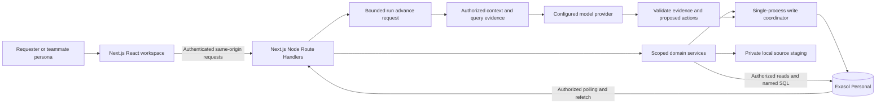
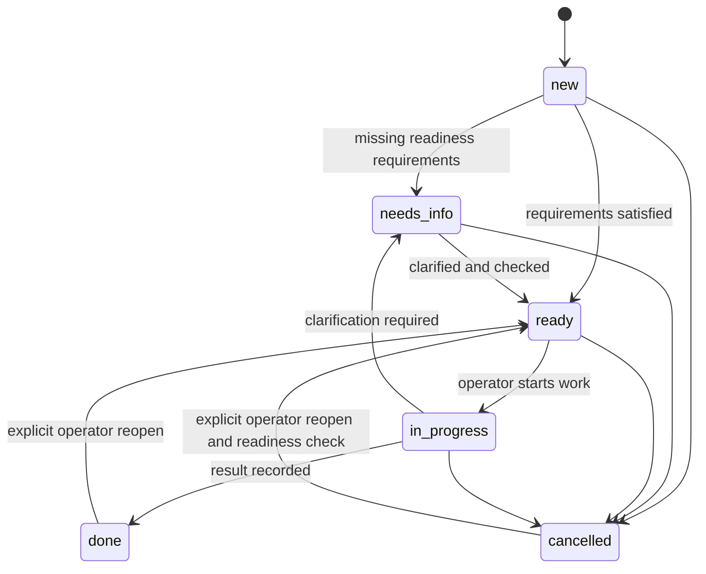

# Loom architecture

Status: revised for Exasol Personal and Next.js; application implementation remains paused. Research reviewed: 2026-10-21.

Loom is a shared internal-tool workspace. The first workflow is a data-request desk: collect requirements, clarify missing details, retrieve team guidance, propose ownership, and track resolution. The design preserves a reusable request-and-review engine while limiting the first product to one workflow family.

No application or infrastructure described here is implemented yet. [TECH_STACK.md](TECH_STACK.md) selects the proposed dependencies; [PLAN.md](PLAN.md) defines delivery and acceptance checks.

## 1. Research method and limits

This document screens **27 research papers and 26 public GitHub repositories** across generated interfaces, human-agent collaboration, retrieval, memory, authorization, transactions, and evaluation. The registers below link primary sources and explain their relevance. Most papers were screened through abstracts or author publication summaries; selected full-text sections were examined for the closest design questions. Repository review covered READMEs and selected documentation, not source-code audits, benchmark reproduction, or local execution.

This is a focused architecture review, not an exhaustive systematic literature review. Some sources are peer-reviewed papers, others are preprints or workshop work. Vendor-authored memory benchmarks and simulated-human studies have limited transfer to Loom. Repository default branches and documentation can change; pin versions/commits when adopting code.

Research motivates patterns; it does not prove that this architecture is secure, useful, or faster. Explicit choices such as Exasol Personal, Next.js, a modular backend, and the initial role model are engineering decisions to validate through implementation and pilot evaluation.

## 2. Decisions the evidence changes

| Decision | Research/repository basis | Loom interpretation and limit |
| --- | --- | --- |
| Generate a persistent specification using supported components | [Jelly](https://arxiv.org/abs/2503.04084), [json-render](https://github.com/vercel-labs/json-render), [A2UI](https://github.com/a2ui-project/a2ui) | Store data, views, and allowed action references. Generation cannot create executable code or authority. Small research prototypes do not establish enterprise readiness. |
| Combine prompts with direct controls | [DynaVis](https://arxiv.org/abs/2401.10880), [Data Formulator 2](https://www.microsoft.com/en-us/research/publication/data-formulator-2-iteratively-creating-rich-visualizations-with-ai/) | Use prompts to express intent, and forms/tables to repeat work. Keep editable drafts and history. Visualization results are suggestive for internal tools, not direct evidence. |
| Coordinate through shared state and visible responsibilities | [Collaborative Gym](https://arxiv.org/abs/2412.15701), [shared-workspace study](https://arxiv.org/abs/2606.18413) | Humans and the agent refer to the same record IDs and versions. Ownership and review are explicit. The latter study uses simulated collaborators. |
| Measure outcomes instead of assuming collaboration helps | [human-AI meta-analysis](https://arxiv.org/abs/2405.06087), [tau-bench](https://arxiv.org/abs/2406.12045) | Compare manual, assisted, and bounded autonomous evaluation baselines; check final database state and repeatability. No productivity claim is inherited from these studies. |
| Retrieve scoped evidence rather than stuffing all history into a prompt | [RAG](https://arxiv.org/abs/2005.11401), [Lost in the Middle](https://arxiv.org/abs/2307.03172), [ALCE](https://arxiv.org/abs/2305.14627) | Assemble a small context with versioned source references. A citation can exist without supporting a recommendation; evaluate support separately. |
| Give reusable knowledge a lifecycle and provenance | [MemGPT](https://arxiv.org/abs/2310.08560), [Zep](https://arxiv.org/abs/2501.13956), [LongMemEval](https://arxiv.org/abs/2410.10813) | Separate run context, case history, and approved guidance; retain temporal validity and sources. A reviewed rule is authoritative only within its approved scope. |
| Keep action authorization outside the model | [AgentDojo](https://arxiv.org/abs/2406.13352), [InjecAgent](https://arxiv.org/abs/2403.02691), [CaMeL](https://arxiv.org/abs/2503.18813) | Treat retrieved instructions as untrusted content. Enforce allowed commands and approvals in code. Loom is not an implementation of CaMeL and inherits none of its formal guarantees. |
| Use transactional records and version checks first | [Zanzibar](https://research.google/pubs/zanzibar-googles-consistent-global-authorization-system/), [Sagas](https://www.cs.cornell.edu/andru/cs711/2002fa/reading/sagas.pdf), [Exasol transactions](https://docs.exasol.com/db/latest/database_concepts/transaction_management.htm) | Recheck current authority at commit; use short atomic local writes and durable notifications. Compensation becomes relevant for later external effects. |
| Defer CRDTs and graph infrastructure | [replicated JSON](https://arxiv.org/abs/1608.03960), [local-first software](https://www.inkandswitch.com/essay/local-first/), [GraphRAG](https://arxiv.org/abs/2404.16130) | The MVP needs shared saved records, not offline merging or corpus-wide sensemaking. Revisit these technologies when measured requirements justify them. |

## 3. System invariants

1. **The database is authoritative.** Chat history, browser state, model output, and refresh notifications are not the business record.
2. **Every operation has a workspace and actor.** Agent runs carry an initiating user, delegation scope, and selected record set. Background processing does not elevate that user's permissions.
3. **Models propose; the command service commits.** The agent cannot approve its own proposals or bypass the action registry.
4. **Approval binds exact content.** The server binds a review to immutable parameters, expected revisions, evidence dependencies, and a canonical hash.
5. **Current permissions and dependencies are checked again at commit.** A valid earlier read or token is insufficient for a later write.
6. **Tool publication and record updates are separate operations.** A schema draft cannot silently migrate or erase live data.
7. **Exceptions are not automatically policies.** Reusable knowledge needs an explicit owner-reviewed publication.
8. **Authorized reads precede context construction.** Filter sources, records, caches, citations, and exports before exposing content to a model or user.
9. **Notifications follow committed changes.** Record changes, audit events, idempotency records, and outbox entries commit together.
10. **Retries are expected.** Domain commands remain idempotent even if jobs, network requests, or events repeat.

## 4. Runtime topology



One self-hosted Next.js Node process serves pages and APIs. Server Components perform authorized initial reads; Client Components implement forms, tables, filters, and review. Route Handlers call framework-independent domain/repository modules. Keep Exasol and model credentials in server-only modules. A protected page does not authorize a separate endpoint; every handler rechecks access. Private responses and caches must never cross identities.

Exasol is the sole canonical domain store and analytical engine. There is no required PostgreSQL/Supabase side store. A private local volume stages bounded uploads. The browser never connects to Exasol or receives its credentials.

Agent runs use persisted Exasol checkpoints and bounded authenticated advance requests. Provider calls occur outside database transactions and the write coordinator. Disconnects/crashes leave resumable state; neither detached promises nor Next.js `after()` constitute a durable queue. A future unattended runner requires explicit scheduling/recovery and coordination design.

The single write coordinator serializes all mutations, including membership/rule publication and run persistence. This is an intentionally small single-instance baseline, not a distributed lock. M0 must verify the production Next build shares it across routes. Replicas, serverless instances, and direct database writers are outside this contract. See [Next.js Node deployment](https://nextjs.org/docs/app/getting-started/deploying), [Route Handlers](https://nextjs.org/docs/app/getting-started/route-handlers), and [`after()`](https://nextjs.org/docs/app/api-reference/functions/after).

## 5. Modules and contracts

| Module | Owns | Must not do |
| --- | --- | --- |
| Workspace and identity | Membership, role checks, actor context | Treat a workspace ID supplied by a client as proof of access. |
| Tool definitions | Drafts, validation, compatible publication, history | Execute expressions or arbitrary schemas generated by a model. |
| Requests | Intake, readiness checks, ownership, statuses, comments | Let a requester write operational fields through generic patch endpoints. |
| Knowledge | Sources, approved guidance, provenance, applicability, retrieval | Promote a correction into global policy without review. |
| Agent runs | Context snapshots, bounded steps, validated suggestions | Commit business updates or impersonate an approver. |
| Proposals and commands | Immutable proposals, review, concurrency, atomic writes | Trust a previous permission check after state changes. |
| Activity and delivery | Audit events, outbox, persisted work, authorized refresh | Claim browser delivery or an external effect occurred merely because it was enqueued. |
| Evaluation | Fixtures, state assertions, quality and cost comparisons | Use an LLM judge as the authorization mechanism. |

Use shared input/output contracts and domain services from Node Route Handlers and bounded run execution. Domain modules do not depend on React or model-provider-specific response objects.

## 6. Data model

Use application-generated UUIDs stored initially as `VARCHAR(36)`, exact numeric revisions, and explicitly tested UTC timestamps. Store workflow fields relationally and custom values/specifications as bounded canonical JSON text validated by Zod. Exasol JSON text is not PostgreSQL JSONB. Test empty-string/null behavior and exact numeric serialization. Do not create tenant-authored SQL tables.

Use enabled primary/composite keys and verified foreign keys; unsupported UNIQUE/CHECK constraints must not appear in migrations. Enforce business predicates in domain code. Confirm invalid inserts fail against the actual installed release, not merely a mock. See [data types](https://docs.exasol.com/db/latest/sql_references/data_types/datatypedetails.htm) and [constraint differences](https://docs.exasol.com/db/latest/migration_guides/oracle/execution/constraints.htm).

| Entity | Important fields and relationships |
| --- | --- |
| `organizations` | Organization identity; not an automatic grant to all workspaces. |
| `workspaces` | `organization_id`, name, notification revision, membership revision. |
| `workspace_memberships` | Enabled primary key `(workspace_id, user_id)`, role, active status, revision. |
| `tools` | `workspace_id`, template family, current published revision pointer. |
| `tool_revisions` | `tool_id`, immutable specification, version, state, parent revision, author, publication time. |
| `requests` | `workspace_id`, `tool_id`, creator/requester, title, business question, owner, priority, due date, status, custom values, readiness findings, `version`. |
| `request_revisions` | Before/after changes, actor, command ID, previous/new version; immutable history. |
| `comments` | Parent request, author, body, visibility (`internal` or `requester_visible`), timestamps. |
| `source_documents` / `source_revisions` | Workspace, uploader, private storage key, content hash, revision, visibility, deletion state. |
| `source_chunks` | Parent source revision, location/span, canonical text and normalized searchable terms; embeddings deferred. |
| `knowledge_items` / `knowledge_revisions` | Kind, content, owner, scope, status, effective interval, precedence metadata, version. |
| `knowledge_evidence` | Knowledge revision to source revision/span or reviewed decision; derived visibility dependencies. |
| `decision_records` | Parent request/proposal, outcome, human explanation, case-specific scope, actor. |
| `agent_runs` / `agent_steps` | Initiator, selected record IDs, fixed budgets, tool/prompt/model versions, status, checkpoint, usage and timings. |
| `proposals` / `proposal_items` | Immutable action inputs, target versions, evidence revisions, expiry, content hash, current lifecycle state. |
| `approvals` / `action_executions` | Reviewer, proposal hash, approval time, execution result, command ID referencing an enabled primary-key receipt. |
| `audit_events` | Workspace, actor and delegated actor, action, resource, request/run/command IDs, revisions, outcome. |
| `outbox_events` | Committed domain event, destination/scope, delivery state, retry information. |
| `command_receipts` | Enabled `(workspace_id, command_id)` primary key, payload hash, result; atomic with domain writes. |
| `work_items` | Run/step identity, expected revision, checkpoint, bounded retry state; no assumed distributed queue leasing. |
| `query_evidence` | Named query/version, parameter digest, scoped source revisions, execution time, row count, bounded result reference. |
| `import_batches` / `import_rows` | Source hash, column mapping, validated preview, row errors, commit key, resulting request IDs. |

All tenant-owned tables include `workspace_id`. Composite foreign keys such as `(workspace_id, request_id)` prevent cross-workspace references even if application code supplies a valid ID from another workspace. Apply the same protection to source evidence, proposal targets, comments, owners, and tool references. An owner assignment must reference an eligible active member of the same workspace.

Design scoped query predicates for queue filters, membership lookup, active guidance, source revisions, and history. Measure Exasol query plans and runtime before adding platform-specific tuning; do not copy PostgreSQL index DDL. Semantic retrieval is deferred.

## 7. Authorization and trust boundaries

### 7.1 Product roles

Roles are workspace-scoped. Platform/database administrators are operational identities outside this product matrix.

| Operation | Owner | Operator | Requester | Viewer |
| --- | --- | --- | --- | --- |
| Read internal queue and internal comments | Yes | Yes | No | Yes |
| Submit and read own requests | Yes | Yes | Yes | Read only |
| Edit own request description / add requester-visible comment | Yes | Yes | Yes, own only | No |
| Change owner, priority, due date, status | Yes | Yes | No | No |
| Run internal triage agent | Yes | Yes | No in MVP | No |
| Review and apply record proposals | Yes | Yes | No | No |
| Read approved internal guidance and its permitted evidence | Yes | Yes | No | Yes |
| Draft guidance or record a correction | Yes | Yes | No | No |
| Publish/retire guidance, publish tool revisions, manage membership | Yes | No | No | No |

Requesters receive explicitly requester-visible comments and a safe subset of request fields. Internal reasoning, other requesters' records, internal comments, and internal evidence are excluded. Viewer access is intentionally broad read-only internal access; use it only for authorized internal colleagues.

### 7.2 Identity and scoped data access

The backend verifies signature, issuer, audience, expiry, and configured token algorithm, derives the actor, and queries current membership. Client-supplied user IDs and JWT role claims cannot replace current authorization. Local synthetic demo identities are explicitly isolated from production mode.

Every repository operation requires verified actor/workspace scope and binds values in reviewed SQL. Requester queries additionally constrain requester identity and project only permitted fields. Apply this to counts, joins, analytics, source text, proposal evidence, activity, and exports. Test forged IDs and cross-workspace references. There is no assumed PostgreSQL RLS, transaction-local actor setting, or Supabase policy enforcement.

Exasol credentials remain server-side. Restrict database/schema privileges to the available deployment's required operations and separate migration access where supported. SQL privileges supplement application authorization; they do not automatically implement per-person workspace policy. Model output cannot choose SQL identifiers or acquire database credentials.

Personal is documented for individual use with a single-user restriction. Synthetic personas demonstrate the intended product roles; they do not establish permission for a real multi-user service. Verify applicable organizer/vendor terms and the appropriate edition before shared rollout. See [Personal](https://docs.exasol.com/db/latest/get_started/exasol_personal.htm) and [GRANT](https://docs.exasol.com/db/latest/sql/grant.htm).

### 7.3 Delegation and revocation

Execution requests rehydrate a server-created run, not a client-invented actor. Recheck active user and membership before retrieving content, persisting results, exposing outputs, or executing an approved command. A long-lived job does not rely on a stale browser token or cached role.

All membership changes, knowledge publication, and record commands pass through the same single-process coordinator. Inside an exclusive Exasol transaction, reread authority, dependency revisions, and target versions before writing. Exasol uses serializable transactions with object-level locking and possible collision rollbacks; do not assume row locks or SELECT FOR UPDATE. Retry the entire idempotent transaction from a fresh snapshot within a bounded budget. Direct writers or multiple application processes invalidate this baseline and need a new concurrency design.

Content already sent to a provider cannot be recalled after revocation. Minimize context, check access immediately before calls, cancel further work, and suppress later output when authority is lost. Storage access, API reads, context caches, and evidence displays recheck current permissions. Document provider data handling before using real pilot data.

## 8. Tool specification and publication

`ToolSpec` is a declarative document that references only known field types, components, built-in system fields, and action IDs. It does not contain JavaScript, SQL, HTML, arbitrary remote URLs, or expressions to evaluate.

Illustrative specification; system fields such as `status`, `owner_id`, and `due_at` are defined by the request-desk family:

```json
{
  "schemaVersion": 1,
  "templateId": "request-desk",
  "title": "Data requests",
  "fields": [
    {"id": "business_question", "type": "text", "requiredAt": "intake"},
    {"id": "reporting_period", "type": "text", "requiredAt": "ready"}
  ],
  "views": [
    {
      "id": "queue",
      "component": "request_table",
      "columns": ["business_question", "reporting_period", "owner_id", "status", "due_at"]
    },
    {"id": "intake", "component": "request_form"}
  ],
  "actions": ["request.assign_owner", "request.transition", "request.add_comment"]
}
```

Publication pipeline:

1. Parse a model response with the shared specification schema and size/depth limits.
2. Check field/component/action allowlists, reference integrity, reserved keys, and compatible schema version.
3. Verify the owner is allowed to publish; displaying an action reference cannot grant its execution permission.
4. Compare with the published definition and classify data compatibility.
5. Persist an immutable draft, show its diff and impact, and publish with the expected current revision.
6. Notify clients after commit; active forms can finish against a supported revision or receive a revision-conflict response.

MVP edits can change labels, visibility, fixed filter descriptors, and add optional fields. Adding a readiness requirement marks older requests as needing review without deleting them. Removing data-bearing fields, changing types, renaming stable keys, arbitrary new workflow states, and destructive migrations are deferred.

Use fixed code-owned Zod contracts to validate finite generated descriptors. Loom's own validators implement supported field requirements. Never evaluate generated expressions, compile untrusted schemas into executable code, or treat a model-authored schema as an authorization policy.

Restoring an older compatible tool definition creates a new publication revision. It does not roll back request records or external events.

## 9. Request workflow and command service



Required intake fields are hard validation at normal submission. CSV imports can preserve incomplete historical work with findings and `needs_info` status. Moving to `ready` or `in_progress` requires current readiness checks. Due-date and overdue calculations are deterministic UTC operations; timestamps are formatted in the viewer's timezone.

Each command declares input schema, permitted roles, editable fields, target constraints, preconditions, effect, idempotency rules, and audit representation. Initial commands include create request, edit requester fields, assign owner, transition status, add comment, save clarification draft, publish tool revision, and publish/retire knowledge.

Manual controls and approved agent proposals call the same command implementations. Drafting a reply stores text in Loom; sending a message to an external system is a different capability and is deferred.

## 10. Team knowledge and retrieval

### 10.1 Separate kinds of memory

| Kind | Authority and lifecycle |
| --- | --- |
| Run working context | Short-lived inputs and checkpoints tied to one task; not a policy store. |
| Request history | Historical facts and human decisions scoped to a request. |
| Approved procedure/routing rule | Owner-reviewed, versioned, applicable to an explicit workspace/tool/topic. |
| Glossary/definition | Owner-reviewed meaning with provenance and effective interval. |
| Draft extracted insight | Candidate knowledge; excluded from authoritative instructions. |
| Case exception | An observed decision that remains local unless separately generalized and approved. |

A knowledge item transitions from draft to approved, then superseded or retired. Record `valid_from`, optional `valid_to`, `recorded_at`, approver, source revisions, and applicability. Keep historical revisions queryable for authorized audit while using only currently applicable approved revisions for new recommendations.

Approved prose guides recommendations; it is not executable security policy. A statement such as "route revenue requests to Finance Analytics" can support an owner suggestion, but cannot grant access or bypass required fields and review. Any rule that must be enforced deterministically needs a supported typed rule descriptor, owner review, and domain tests before activation. The MVP must explicitly reject unsupported enforcement requests rather than presenting saved prose as an enforced control.

### 10.2 Ingestion and evidence

MVP inputs are bounded plain text/Markdown, manually entered guidance, and decisions made inside Loom. Private source upload creates a source revision and indexing job. Parsing and extraction generate chunks and optional draft knowledge. Extracted claims require review before serving as policy.

Every excerpt/evidence reference uses a server-resolved source ID, immutable revision, and location/span; the model cannot invent an arbitrary citation URL. Display human-readable evidence only after checking its current visibility. Preserve provenance across derived guidance. Publishing a derived rule cannot broaden the visibility of restricted evidence without an explicit authorized publication/redaction decision.

Retiring/deleting a source removes it from retrieval and invalidates dependent guidance/proposals. Preserve a tombstone and non-sensitive audit metadata; apply the chosen retention/deletion policy to raw content and copies. Do not preserve prohibited raw text merely to keep an audit display convenient.

### 10.3 Retrieval sequence

1. Resolve the workspace, current actor, authorized selected requests, current tool revision, and task intent.
2. Fetch structured facts and exact identifiers through SQL.
3. Filter knowledge by current visibility, approved status, applicable scope, effective date, and active source dependencies.
4. Search the authorized candidate set using bounded normalized-term lookup and exact glossary/routing keys in Exasol.
5. If adopted after evaluation, fuse semantic candidates with lexical candidates and deduplicate by source revision.
6. Assemble a bounded context with stable evidence IDs, timestamps, active guidance, and relevant case history clearly distinguished.
7. Check access again before model submission and result delivery. Revalidate dependencies before any later command commit.

Start without embeddings or PostgreSQL full-text search. Evaluate normalized-term/key retrieval on the small authorized corpus. If paraphrase failures justify semantic search, choose an Exasol-compatible implementation only after a frozen recall/isolation comparison; pgvector is not an Exasol extension.

Caches include workspace, actor visibility/membership revision, query intent, and source/knowledge versions. Requester and internal caches cannot be shared blindly. Invalidate cached derived content on source retirement or role change. For small MVP loads, prefer no shared semantic-result cache.

Conflicting approved rules produce an explicit clarification need. Authority comes from configured scope/precedence and owner review, not whichever document has the most recent timestamp. Absence of evidence, a retrieval outage, and a model failure are different states shown to the user.

## 11. Agent lifecycle

The operating agent is a bounded task runner using one configured model and known tools. It is separate from tool-definition generation, even if both use the same provider adapter.

```text
queued -> running -> completed
                 -> failed
                 -> cancelled
                 -> timed_out

running steps:
validate scope -> gather records -> retrieve guidance -> generate suggestions
-> validate evidence and actions -> persist pending-review proposals
```

A completed run means suggestions were generated and stored, not that proposed work was applied. Human review has its own durable proposal lifecycle; no model session or database transaction stays open waiting for approval.

Allowed agent tools: read selected/authorized requests, read authorized comments, retrieve approved guidance, find permitted related records, and propose known actions. Query parameters cannot expand the selected-record mutation scope. Reading a related record does not authorize changing it. The agent has no approval, generic SQL, shell, browser, arbitrary HTTP, or external-message tool in the MVP.

The context envelope records selected record versions, tool revision, knowledge/evidence revisions, prompt version, model identifier, user intent, and bounded action scope. ReAct motivates interleaved retrieval and action selection, but Loom uses short inspectable steps rather than depending on or displaying hidden model reasoning. Persist tool calls, outputs, evidence, brief user-facing rationales, and usage; do not require private chain-of-thought.

Persist checkpoints after successful expensive steps through the write coordinator. An authenticated advance endpoint executes bounded work and uses persisted step identity/revision to reject duplicate completion. Do not hold a database transaction during provider calls. On retry, reuse a completed step only if its inputs, permissions, and dependencies remain valid. Record partial failures per request; never manufacture a successful triage result for failed items. Once a draft proposal is exposed as pending review, it is immutable; a retried step cannot overwrite it.

Initial limits are set in [PLAN.md](PLAN.md). Cancellation applies to queued/running runs, sets a persistent flag, attempts to abort the provider request, and blocks subsequent persistence/execution after rechecking the flag. Once a run has completed, users reject its pending proposals instead of changing the completed run to cancelled. Already completed approved commands remain committed and visible. Agent run cancellation does not undo historical changes.

## 12. Proposal, approval, and execution protocol

### 12.1 Immutable review payload

Each proposal stores a server-computed digest over canonical action content:

```text
workspace + proposal revision + selected item IDs + action IDs + exact parameters
+ target record versions + tool revision + evidence/rule revisions
+ expiry + initiating scope
```

The review UI shows before/after field values, affected records, evidence, and any uncertainty. Treat model text as untrusted and render it safely. The hash is not a replacement for authentication; it binds authenticated review to exact server-stored content.

Editing a suggestion creates a new immutable revision, supersedes the old one, and requires a new review. For a subset of a batch, create/display the exact selected proposal revision or reviewed item-hash set before approval. Adding an item to an approved batch requires fresh review.

### 12.2 Commit sequence

For local MVP actions, `approve` validates and executes within one short database transaction:

1. Verify current reviewer identity and current owner/operator permission.
2. Enter the shared write coordinator; exclusively own one connection with autocommit disabled. Reread proposal, memberships, dependencies, and targets in the transaction.
3. Verify pending-review state, unexpired proposal, hash, selected scope, initiator delegation, and reviewer access to all action evidence/targets.
4. Verify expected target versions, current published tool revision, current applicable rule/evidence revisions, and command preconditions.
5. Check the enabled primary-key command receipt. The same command ID with a different payload is a conflict; a recorded matching result is replayed only after current access checks.
6. Apply commands; atomically write request revisions, approval, execution result, audit events, and outbox entries.
7. Persist proposal state and the command receipt, then commit. Only acknowledge success after commit; subsequent authorized reads see the saved result.

Verify conditional version updates report the expected affected-row count; do not assume PostgreSQL RETURNING semantics. On a transaction collision, roll back and retry the full command with fresh reads. On a lost commit acknowledgement, reconcile by command ID before retrying. All selected items in an MVP approval batch commit together or none do. A partial batch needs a separately reviewed selection. There are no external network calls inside this transaction.

If stale, expired, denied, or invalid, no business records change. Return a clear reason with an authorized current-state view. Stale-state marking and attempted-review metadata may be recorded in a separate permitted transaction after the failed command transaction rolls back. A new suggestion must be reviewed again; never silently rebase an approved patch onto newer data.

### 12.3 Sequence example

```mermaid
sequenceDiagram
  participant A as Bounded agent run
  participant D as Database
  participant H as Reviewer
  participant C as Command service
  A->>D: Read request v7 and approved rule r3
  A->>D: Store immutable proposal and dependencies
  H->>C: Load review payload
  C->>D: Read authorized proposal and evidence
  C-->>H: Exact review payload
  H->>C: Approve proposal hash and selected items
  C->>D: Coordinate transaction and validate authority, revisions, receipt
  alt Record and rule still current
    C->>D: Commit update v8, approval, audit, outbox
    C-->>H: Applied
  else Another person changed the record or rule
    C-->>H: Conflict; refresh and review a new proposal
  end
```

Undo is an explicit compensating local command with its own version and permission checks, not a time machine. If another person has edited the record, show the resulting conflict. Tool revision restoration and record compensation are distinct operations.

## 13. Shared saved records and recovery

Saved Exasol records are authoritative. Optimistic edits remain visibly pending until acknowledged; expected revisions prevent silent overwrites. Initially use authenticated polling/refetch after mutations, focus, reconnect, and a configurable interval. Recheck current membership and field visibility on every request, including metric counts and activity. Clear inaccessible client data after denied refresh and isolate query caches by identity/workspace.

Domain events, audit, command receipts, and outbox entries commit atomically. The outbox preserves delivery intent and supports later invalidation delivery; initial correctness does not depend on a notification dispatcher. Durable steps and work items support bounded request-driven run recovery without pg-boss. Duplicate advancement or command requests must reconcile persisted identities/results.

Optional SSE or presence can follow the working baseline. Scope any stream using current access, use minimal non-sensitive invalidations, bound authorization lifetime, and refetch through authorized endpoints. Notifications may repeat, reorder, or disappear; they cannot authorize reads or replace record versions. No exactly-once network-delivery guarantee is claimed.

## 14. API surface

All routes below are proposed Next.js Node Route Handlers and workspace-scoped. Cookie-authenticated mutations require origin/CSRF checks; credentials never use NEXT_PUBLIC variables. IDs are checked for ownership; request/response serializers apply field visibility.

| Operation | Proposed route | Key contract |
| --- | --- | --- |
| Generate tool draft | `POST /api/workspaces/:w/tools/drafts` | Owner; bounded description; creates asynchronous generation run. |
| Publish a tool revision | `POST /api/workspaces/:w/tools/:t/publish` | Owner; draft ID and expected published revision. |
| List/create requests | `GET/POST /api/workspaces/:w/tools/:t/requests` | Role-scoped filters and editable fields. |
| Execute manual request command | `POST /api/workspaces/:w/requests/:r/commands` | Known command ID, expected version, idempotency key. |
| Preview/commit import | `POST /api/workspaces/:w/imports`, `POST .../imports/:i/commit` | Owner/operator; bounded file, validated mapping, exact preview revision. |
| Retrieve knowledge | `GET /api/workspaces/:w/knowledge/search` | Internal access; approved/applicable results and permitted evidence. |
| Publish guidance | `POST /api/workspaces/:w/knowledge/:k/publish` | Owner; expected version, sources, scope, precedence. |
| Start/read/cancel agent run | `POST/GET /api/workspaces/:w/runs`, `POST .../runs/:id/cancel` | Role and run ownership; fixed selected scope and budget. |
| Advance persisted run | `POST /api/workspaces/:w/runs/:id/advance` | Current authorization, bounded step budget, expected checkpoint revision. |
| Read analytical evidence | `GET /api/workspaces/:w/analytics/:queryId` | Code-owned named query, validated bound filters, scoped result and evidence. |
| Review proposal | `GET /api/workspaces/:w/proposals/:p` | Current target/evidence visibility. |
| Approve or reject | `POST /api/workspaces/:w/proposals/:p/approve`, `POST .../reject` | Exact hash/selection, expected proposal revision, reviewer and command checks. |
| Read activity | `GET /api/workspaces/:w/activity` | Internal history or separately filtered own-request activity. |

Use `401` for invalid identity, `403` for denied capabilities, `404` for unknown or intentionally undisclosed resources, `409` for version/idempotency conflicts, `422` for unsupported/invalid specifications, and `429` for resource limits. Errors contain a stable code and request ID without leaking another workspace's data.

## 15. Failure and recovery behavior

| Failure | Required behavior |
| --- | --- |
| Model emits invalid fields/actions | Reject output; bounded repair attempt; preserve draft/error without executing. |
| Evidence absent or contradictory | Explain missing/ambiguous guidance; request clarification; do not invent authority. |
| Retrieval/indexing unavailable | Surface temporary failure; distinguish it from no results. Manual request operations remain available. |
| Record/tool/rule changes during review | Reject stale execution, show a permitted current view, and require fresh review. |
| Membership revoked during a run | Stop later retrieval/delivery; block command commit; retain access-restricted audit metadata. |
| API response lost after commit | Same idempotency key returns the recorded execution result after authorization. |
| Server/request execution interrupted | Resume through a new authenticated advance request from persisted state; reuse only valid checkpoints; reject duplicate completion. |
| Notification missed | Authorized refresh on reconnect/focus/next operation restores current state. |
| Import fails mid-processing | Keep preview/error state; commit an approved bounded batch atomically; retry cannot duplicate committed rows. |
| Run cancelled/timed out | Persist terminal state and partial item outcomes; block subsequent proposed/apply work for that cancelled run. |
| Source removed | Remove retrieval access, invalidate derived authority, and redact protected evidence displays. |
| Later connector times out after a remote call | Mark outcome uncertain and reconcile by provider idempotency/status APIs; never assume failure means no effect. |

Keep file processing bounded and outside transactions. CSV exports protect against spreadsheet formula injection. Markdown is rendered with raw HTML disabled or sanitized. Do not fetch arbitrary linked URLs, accept generated code, or log source contents by default.

## 16. Evaluation and operations

Use three product conditions: existing workflow, Loom with manual controls, and Loom with the agent. For agent task evaluation, also test an autonomous bounded baseline on synthetic data to identify whether review actually improves outcomes. The research on human-AI combinations motivates measuring both benefit and coordination overhead.

Evaluate final database state, proposal correctness, policy compliance, evidence support, retrieval recall, abstention, memory updates, and repeated-run consistency. Judge phrasing separately from action correctness. [PLAN.md](PLAN.md) defines initial fixtures and proposed gates; none are measured results yet.

Required integration scenarios include two-workspace isolation; own-request restrictions; internal-comment filtering; concurrent updates; rule/source retirement during approval; role revocation races; tampered proposal hashes; duplicate approvals; cancelled/restarted jobs; out-of-order notifications; poisoned source instructions; and forged evidence references.

Correlate API request, workspace, run, step, proposal, command, and outbox IDs. Track queue age, retries, validation failures, blocked/stale proposals, review time, provider usage, and completed work. Keep credentials and full private content out of ordinary logs; observability exports require the same data-handling review as any other third-party service.

Deploy one self-hosted Next.js Node process alongside local Exasol Personal for the synthetic event demo. Verify connection limits, TLS trust, health/readiness, graceful shutdown, explicit migrations, and backup/restore. No installation or deployment has been performed during this documentation revision. Keep any future licensed shared environment separate. Database audits are append-only to ordinary product roles, not cryptographically immutable against database administrators. Retention and deletion must cover uploaded sources, derived chunks, cached context, and provider/log copies where applicable.

## 17. Architecture decisions and expansion triggers

| ID | Decision | Revisit trigger |
| --- | --- | --- |
| ADR-001 | Next.js App Router, Node handlers, modular TypeScript domain services | Independently scaling or specialized workloads appear in measurements. |
| ADR-002 | Loom-owned persistent `ToolSpec`; fixed renderer catalog | M0 adapter evaluation or real workflow requirements demand a wider protocol. |
| ADR-003 | Exasol Personal as sole canonical domain store and analytical engine; validated JSON text | Real SQL/driver tests or measured write contention require reconsideration without weakening event requirements. |
| ADR-004 | Explicit server/repository workspace and own-request predicates | Nested sharing relationships justify OpenFGA or equivalent. |
| ADR-005 | Review-bound proposals, version checks, atomic local execution | External actions require per-connector authorization and reconciliation. |
| ADR-006 | Approved scoped guidance distinct from case history | A real workflow requires a richer authority/temporal model. |
| ADR-007 | Structured/lexical retrieval first | Frozen evaluation demonstrates semantic retrieval adds material value. |
| ADR-008 | Exasol receipts/outbox/checkpoints and one process-wide mutation coordinator | Multiple writers, unattended jobs, or replicas require a new scheduling/concurrency contract. |
| ADR-009 | Saved-record collaboration without CRDT | Offline writes or character-level simultaneous editing become necessary. |
| ADR-010 | One bounded agent, no autonomous agent team | Measured tasks require independent specialist execution beyond the current runner. |

External connectors, scheduled autonomous work, PDF/Office parsing, graph memory, expanded SSO, and multi-workspace sharing need explicit future design. A growing bibliography is not a reason to add all referenced technologies.

## 18. Research paper register

Review depth: **A** = abstract/author publication summary; **S** = selected full-text sections or results also examined. Years indicate first publication/preprint unless a conference is explicitly named. Each implication is Loom's interpretation, not a claim the source tested Loom.

| ID | Primary source | Depth | Contribution, limitation, and use |
| --- | --- | --- | --- |
| P01 | Cao et al., [Generative and Malleable User Interfaces with Generative and Evolving Task-Driven Data Model](https://arxiv.org/abs/2503.04084), CHI 2025 | S | Jelly generates/refines UI from task models; supports persistent specifications. Eight-person exploratory study and limited task/layout coverage. |
| P02 | Vaithilingam et al., [DynaVis: Dynamically Synthesized UI Widgets for Visualization Editing](https://arxiv.org/abs/2401.10880), CHI 2024 | S | Persistent controls complement language; informs direct manipulation. Visualization-specific, 24-person study; not an internal-workflow trial. |
| P03 | Wang et al., [Data Formulator 2](https://www.microsoft.com/en-us/research/publication/data-formulator-2-iteratively-creating-rich-visualizations-with-ai/), CHI 2025 | A | Blended interaction and iteration history; informs draft/history UX. Eight participants; visualization authoring scope. |
| P04 | Amershi et al., [Guidelines for Human-AI Interaction](https://www.microsoft.com/en-us/research/publication/guidelines-for-human-ai-interaction/), CHI 2019 | A | Interaction guidance and practitioner evaluation; informs correction and capability visibility. Not a guarantee of usable or correct automation. |
| P05 | Shao et al., [Collaborative Gym](https://arxiv.org/abs/2412.15701), 2024; revised 2026 | S | Shared environment and process/outcome evaluation; informs dual control and task metrics. Task-specific comparisons do not establish Loom productivity. |
| P06 | Kotalwar et al., [Searching for Synergy in Shared Workspace Human-AI Collaboration](https://arxiv.org/abs/2606.18413), 2026 workshop/preprint | S | Coordination structures and shared memory; informs ownership/review. Human collaborators are simulated, limiting external validity. |
| P07 | Vaccaro et al., [When combinations of humans and AI are useful](https://arxiv.org/abs/2405.06087), Nature Human Behaviour 2024 | S | Meta-analysis distinguishes augmentation from outperforming the better solo baseline; motivates controlled evaluation. Heterogeneous tasks and systems. |
| P08 | Lewis et al., [Retrieval-Augmented Generation for Knowledge-Intensive NLP Tasks](https://arxiv.org/abs/2005.11401), NeurIPS 2020 | A | External retrieval plus generation; foundation for evidence context. Original model/training and Wikipedia tasks differ from enterprise policies. |
| P09 | Liu et al., [Lost in the Middle: How Language Models Use Long Contexts](https://arxiv.org/abs/2307.03172), 2023 preprint | A | Context position affects retrieval/use; motivates bounded relevant context. Does not establish a universal limit for current models. |
| P10 | Asai et al., [Self-RAG](https://arxiv.org/abs/2310.11511), 2023; ICLR 2024 | A | Adaptive retrieval and critique; motivates relevance/support checks. A trained reflection-token method, not equivalent to asking a generic model to verify itself. |
| P11 | Gao et al., [Enabling Large Language Models to Generate Text with Citations](https://arxiv.org/abs/2305.14627), EMNLP 2023 | A | ALCE separates correctness and citation quality; informs evidence evaluation. Citation formatting alone does not imply support. |
| P12 | Packer et al., [MemGPT: Towards LLMs as Operating Systems](https://arxiv.org/abs/2310.08560), 2023 | A | Memory tiers and context management; informs run/history/knowledge separation. Not a policy governance architecture. |
| P13 | Park et al., [Generative Agents: Interactive Simulacra of Human Behavior](https://arxiv.org/abs/2304.03442), 2023 | A | Observation, retrieval, and reflection; informs candidate insight extraction. Evaluates simulated behavior/believability, not enterprise truth or authorization. |
| P14 | Chhikara et al., [Mem0: Building Production-Ready AI Agents with Scalable Long-Term Memory](https://arxiv.org/abs/2504.19413), 2025 | A | Extraction/consolidation and memory evaluation; informs lifecycle comparisons. Vendor-authored conversational benchmarks do not establish Loom's quality or cost. |
| P15 | Rasmussen et al., [Zep: A Temporal Knowledge Graph Architecture for Agent Memory](https://arxiv.org/abs/2501.13956), 2025 | S | Episodes, temporal facts, invalidation, and retrieval; informs provenance/effective intervals. Vendor-authored graph architecture; adopting its concepts does not require its backend. |
| P16 | Edge et al., [From Local to Global: A Graph RAG Approach to Query-Focused Summarization](https://arxiv.org/abs/2404.16130), 2024 | A | Community summaries address corpus-wide questions. Loom's initial exact request/rule lookup does not justify this pipeline. |
| P17 | Yao et al., [ReAct: Synergizing Reasoning and Acting in Language Models](https://arxiv.org/abs/2210.03629), 2022; ICLR 2023 | A | Interleaved reasoning/actions/retrieval; informs bounded tool use. Adds no authorization or injection-resistance guarantee. |
| P18 | Yao et al., [tau-bench: A Benchmark for Tool-Agent-User Interaction in Real-World Domains](https://arxiv.org/abs/2406.12045), 2024 | S | Policy-following, final-state evaluation, and repeated-trial reliability; informs command assertions. Simulated users and benchmark domains differ from a pilot team. |
| P19 | Debenedetti et al., [AgentDojo](https://arxiv.org/abs/2406.13352), 2024 | A | Tests tool agents on untrusted data and attacks; informs adversarial fixtures. Passing a finite suite is not proof of injection immunity. |
| P20 | Zhan et al., [InjecAgent](https://arxiv.org/abs/2403.02691), Findings of ACL 2024 | A | Indirect injection and exfiltration scenarios; informs source/tool trust boundaries. Historical model attack rates are not forecasts for Loom. |
| P21 | Debenedetti et al., [Defeating Prompt Injections by Design](https://arxiv.org/abs/2503.18813), 2025 | S | CaMeL separates control/data and enforces capabilities; informs server-enforced actions. Loom does not implement the interpreter or inherit the paper's guarantees. |
| P22 | Kleppmann and Beresford, [A Conflict-Free Replicated JSON Datatype](https://arxiv.org/abs/1608.03960), 2016; revised 2017 | A | Formal convergence for replicated JSON; reference for later collaborative document editing. Convergence does not enforce approval/business semantics. |
| P23 | Kleppmann et al., [Local-first software: You own your data, in spite of the cloud](https://www.inkandswitch.com/essay/local-first/), Onward! 2019 | S | Collaboration, ownership, and offline design principles. Useful future direction; MVP remains server-authoritative and online. |
| P24 | Pang et al., [Zanzibar: Google's Consistent, Global Authorization System](https://research.google/pubs/zanzibar-googles-consistent-global-authorization-system/), USENIX ATC 2019 | A | Relationship policies and consistency of access decisions. Informs current-authority checks; Google-scale infrastructure is unnecessary here. |
| P25 | Garcia-Molina and Salem, [Sagas](https://www.cs.cornell.edu/andru/cs711/2002fa/reading/sagas.pdf), SIGMOD 1987 | A | Decomposition and compensating transactions; informs later external-action recovery. Compensation cannot universally reverse arbitrary external effects. |
| P26 | Wu et al., [LongMemEval](https://arxiv.org/abs/2410.10813), 2024; revised 2025 | S | Knowledge updates, temporal reasoning, cross-session recall, and abstention; informs memory fixtures. Chat benchmark, not a workflow benchmark. |
| P27 | Es et al., [Ragas: Automated Evaluation of Retrieval Augmented Generation](https://arxiv.org/abs/2309.15217), 2023; revised 2025 | A | Separates retrieval/context and generation evaluation dimensions. Reference-free/judge metrics supplement human labels and deterministic checks. |

## 19. Open-source repository register

Status means a proposed relationship to Loom: **Adopt** = intended dependency/service subject to version/license checks; **Spike** = evaluate a thin adapter; **Reference** = study patterns without a runtime dependency; **Defer** = a possible future dependency requiring evidence. No repository was installed, executed, or forked for this documentation task.

| ID | Repository / reviewed material | Status | Relevant pattern and boundary |
| --- | --- | --- | --- |
| R01 | [appsmithorg/appsmith](https://github.com/appsmithorg/appsmith), README | Reference | Internal-tool composition and data bindings. Full platform breadth exceeds MVP; do not assume hosted features are all community code. |
| R02 | [ToolJet/ToolJet](https://github.com/ToolJet/ToolJet), README/license section | Reference | Component catalog, collaborative app editing, queries/integrations. CE and hosted AI capabilities differ; review exact licensing before reuse. |
| R03 | [Budibase/budibase](https://github.com/Budibase/budibase), README and agent docs | Reference | Apps, data, automations, agents, and review controls. Demonstrates competitive overlap, not a Loom differentiation claim. |
| R04 | [vercel-labs/json-render](https://github.com/vercel-labs/json-render), README/registry examples | Spike | Catalog-based JSON UI and component registry. Keep Loom schema independent; server validation remains necessary. |
| R05 | [a2ui-project/a2ui](https://github.com/a2ui-project/a2ui), README | Reference | Declarative updatable UI and trusted catalog. Former Google URL redirects here; protocol is evolving, so interoperability is deferred. |
| R06 | [microsoft/data-formulator](https://github.com/microsoft/data-formulator), README/publication | Reference | Iterative prompt/direct-control authoring. Its analysis/code-execution functionality is outside Loom's MVP. |
| R07 | [SALT-NLP/collaborative-gym](https://github.com/SALT-NLP/collaborative-gym), README | Reference | Shared environment actions, user intervention, process/outcome evaluation. Evaluation infrastructure is not an enterprise workflow backend. |
| R08 | [langchain-ai/langgraph](https://github.com/langchain-ai/langgraph), README | Defer | Checkpoints, durable state, and human interrupts. For a future TypeScript adoption assess LangGraph.js, not the Python package. |
| R09 | [mem0ai/mem0](https://github.com/mem0ai/mem0), README | Reference | Memory extraction and retrieval patterns. Managed-platform benchmark claims must not be attributed to the open-source SDK. |
| R10 | [getzep/graphiti](https://github.com/getzep/graphiti), README | Defer | Temporal facts, episode provenance, and hybrid graph retrieval. Additional graph operations/backends require a validated need. |
| R11 | [letta-ai/letta-code](https://github.com/letta-ai/letta-code), README and legacy Letta pointer | Reference | Stateful harness and persistent memory. The old Letta repo points to this active source; do not assume the retired V1 server is the current API. |
| R12 | [microsoft/graphrag](https://github.com/microsoft/graphrag), README | Reference | Graph extraction and community summaries. README reports maintenance mode; not selected as a new MVP dependency. |
| R13 | [supabase/supabase](https://github.com/supabase/supabase), README and Auth/RLS/Realtime docs | Reference; superseded | Earlier bundled-platform choice; not part of the Exasol baseline. |
| R14 | [pgvector/pgvector](https://github.com/pgvector/pgvector), README/filtering docs | Reference | Filtered retrieval caveats; PostgreSQL extension cannot be installed into Exasol. |
| R15 | [timgit/pg-boss](https://github.com/timgit/pg-boss), README | Reference; superseded | Durable-job/idempotency patterns; PostgreSQL runtime dependency removed. |
| R16 | [drizzle-team/drizzle-orm](https://github.com/drizzle-team/drizzle-orm), README/transaction docs | Reference; superseded | Typed repository patterns; no assumed Exasol dialect. |
| R17 | [fastify/fastify](https://github.com/fastify/fastify), README/validation docs | Reference; superseded | Fixed-schema/API boundaries; Next.js handles the initial server endpoints. |
| R18 | [vercel/ai](https://github.com/vercel/ai), package README/structured-data docs | Adopt | Provider adapters, tool calls, structured generation. Validate outputs and enforce permissions outside the SDK. |
| R19 | [yjs/yjs](https://github.com/yjs/yjs), README | Defer | Shared types and collaborative text. Not needed for saved-record synchronization. |
| R20 | [automerge/automerge](https://github.com/automerge/automerge), README | Defer | Replicated documents and sync. Offline merging is a different contract from approved business transactions. |
| R21 | [openfga/openfga](https://github.com/openfga/openfga), README | Defer | Zanzibar-inspired relationship authorization. Revisit if membership policies become insufficient. |
| R22 | [temporalio/temporal](https://github.com/temporalio/temporal), README | Defer | Durable workflows and retries. Extra infrastructure is not justified for bounded local proposal generation. |
| R23 | [promptfoo/promptfoo](https://github.com/promptfoo/promptfoo), README | Adopt | Model/prompt comparisons and adversarial evaluation. Judge scores supplement final-state assertions. |

| R24 | [exasol/exasol-personal](https://github.com/exasol/exasol-personal), repository overview and linked setup docs | Adopt | Official Personal launcher; verify current Linux/Podman setup, hardware, version, and edition terms. |
| R25 | [exasol/exasol-driver-ts](https://github.com/exasol/exasol-driver-ts), README and driver user guide | Adopt | Server-only TypeScript adapter, prepared bindings, explicit connection transactions, TLS. Must pass M0 against actual installed Exasol. |
| R26 | [exasol/pyexasol](https://github.com/exasol/pyexasol), README | Defer | Python fallback only if a documented TypeScript compatibility blocker warrants a second runtime. |

## 20. Primary implementation documentation

- [ExaThon India 2026](https://www.exasol.com/events/exathon-india-2026/): exact event requirements summarized in README.
- [Exasol Personal](https://docs.exasol.com/db/latest/get_started/exasol_personal.htm) and [developer hub](https://www.exasol.com/developers/): current setup/edition guidance. Prefer these over outdated general-index platform wording.
- [TypeScript driver user guide](https://github.com/exasol/exasol-driver-ts/blob/main/doc/user_guide/user_guide.md): prepared bindings, Node WebSocket factory, pools, and transaction configuration. A sequence of pool queries is not automatically one transaction.
- [Transactions](https://docs.exasol.com/db/latest/database_concepts/transaction_management.htm): serializable isolation, object locks, collision rollback, and default autocommit.
- [Data types](https://docs.exasol.com/db/latest/sql_references/data_types/datatypedetails.htm), [constraints](https://docs.exasol.com/db/latest/migration_guides/oracle/execution/constraints.htm), and [GRANT](https://docs.exasol.com/db/latest/sql/grant.htm): verify platform differences rather than porting PostgreSQL assumptions.
- [IMPORT](https://docs.exasol.com/db/latest/sql/import.htm), [MERGE](https://docs.exasol.com/db/latest/sql/merge.htm), and [analytic functions](https://docs.exasol.com/db/latest/sql_references/functions/analyticfunctions.htm): staging, deterministic source matching, and event/window analytics.
- [Next.js Route Handlers](https://nextjs.org/docs/app/getting-started/route-handlers), [deployment](https://nextjs.org/docs/app/getting-started/deploying), and [after](https://nextjs.org/docs/app/api-reference/functions/after): application/server boundaries and background execution limits.
- [AI SDK structured generation](https://ai-sdk.dev/docs/ai-sdk-core/generating-structured-data): provider integration; semantic/action validation remains Loom's responsibility.

Before implementation resumes, pin compatible versions, verify actual SQL/driver behavior, and record tested setup. Research findings above are not completed technical spikes.

## 21. Exasol analytical pipeline and evidence contract

1. Stage a bounded synthetic CSV, retain its hash/mapping, and validate rows. Import ordering is not a business identity; use explicit stable source IDs. Normalize values and deduplicate before a deterministic MERGE or reviewed insert transaction. A MERGE statement alone does not guarantee end-to-end command idempotency.
2. Store requests and append status transitions atomically with commands. Derive current queue age, due-date/SLA risk, owner workload, and time per status through reviewed SQL. Use event ordering with an explicit tie-breaker and window functions such as LEAD for status intervals; define reopen/cancel/null behavior in fixtures.
3. Keep SQL in a code-owned registry with query IDs, versions, allowed filters, authorization requirements, and bounded outputs. Models may request known query intents and validated filters; they cannot author arbitrary SQL or identifiers.
4. Return query ID/version, scoped parameters digest, relevant source IDs/revisions, query time, row count, and bounded metrics/evidence. A changing dataset can invalidate a snapshot; recommendations still check target and rule versions at commit.
5. Present simple cards/tables and evidence to the operator and agent. Distinguish observed queue patterns from hypotheses about causes. Explain deterministic duplicate candidates as candidates, not proven duplicate intent.

Verify analytical output against hand-calculated synthetic fixtures and repeat from clean setup. Record measured latency on declared hardware without asserting Exasol performance from marketing or unrelated benchmarks. Exasol must power actual canonical data and insights; removing it should break the real workflow rather than only remove an optional chart.

The single-process coordinator and small write batches are deliberate responses to this analytical database's transaction model. If M0 reveals unacceptable contention or incompatible key/driver behavior, document that result and revise the design before building on it. Do not silently replace Exasol with a mocked or PostgreSQL-backed runtime.
