# Loom

**Catch work before it falls through the cracks.**

Loom helps small analytics teams turn vague business requests into clear, assigned work. It connects chat intake, team knowledge, a reviewable AI assistant, and Exasol workflow analytics in one company workspace.

[Watch demo](https://drive.google.com/file/d/1jJq3Rv_Yzt0LJa1ZIM08QaH1zUglkMgX/view?usp=sharing) · [Pitch deck (PDF)](docs/pitch/loom-pitch.pdf) · [Editable PowerPoint](docs/pitch/loom-pitch.pptx) · [Run guide](RUN_GUIDE.md) · [Architecture](docs/architecture/README.md) · [Demo instructions](docs/demo/README.md)

## The problem

Small analytics teams receive requests in chat, but the reporting period, dataset, metric definition, owner, and deadline often live in separate conversations. Requesters chase updates; analysts chase missing context. Work can remain unassigned, and teams struggle to see where requests spend time.

**Who has this problem?** Business stakeholders who need answers, analysts who must clarify and deliver the work, and analytics leads who coordinate a small queue.

**Why it matters:** unclear requests create repeated clarification, inconsistent definitions, and invisible waiting. Loom makes that coordination visible and actionable. Reduced turnaround time is a hypothesis to evaluate, not a measured result of this prototype.

### A concrete scenario

A sales manager posts in Discord:

> Can the analytics team investigate why sales dropped last week? We need a breakdown by region and product before Monday's leadership meeting.

The analyst still needs exact dates, a comparison period, the source dataset, and a definition of sales. Loom imports the message with its source link. The assistant identifies missing context. The requester supplies:

| Detail      | Clarified request                                                 |
| ----------- | ----------------------------------------------------------------- |
| Period      | October 19–25 versus October 12–18, 2026                          |
| Metric      | Net sales after discounts and refunds, excluding tax              |
| Dataset     | Synthetic orders and refunds                                      |
| Deliverable | Regional/product breakdown and a short explanation for leadership |

The assistant proposes an update; a person reviews and approves it. An owner assigns an analyst and a deadline. The request's activity and original Discord link remain available. An approved net-sales definition can be reused through Knowledge.

**Loom prepares and tracks the investigation. It does not analyze the sales dataset or prove why sales fell.**

## What you can do

- **Requests:** create or import requests, clarify requirements, assign owners, set dates, comment, and track status.
- **Connected sources:** import selected Slack, Teams, or Discord channels; import reference knowledge from GitHub and SharePoint. Connections are read-only.
- **Assistant:** ask about authorized workspace context and review proposed changes before applying them. Use a company API provider or an eligible owner's connected ChatGPT plan.
- **Knowledge:** keep approved definitions and procedures alongside source references; retrieve relevant passages with citations.
- **Insights:** inspect stage waiting time, weekly arrivals/completions/reopenings, backlog, and owner workload, calculated in Exasol.
- **Access:** individual accounts, owner invitations, and owner/operator/requester/viewer roles.

## Architecture



The browser talks to one local Next.js server. Server-side authorization and validation guard every read and write. Exasol is the canonical store and analytical engine; optional model providers propose output, while a person approves mutations. See the [Mermaid source and explanation](docs/architecture/README.md).

## Setup

### Prerequisites

- Node.js 24 recommended (minimum 22.13); pnpm 10.31.0.
- A running Exasol instance with trusted TLS. For the tested Linux x86_64 setup, use Exasol Personal and rootless Podman.
- Internet access for installing dependencies and optional external connections.

```sh
git clone https://github.com/minnhaaaaa/Loom.git
cd Loom
pnpm install --frozen-lockfile
# Fresh checkout only; never overwrite an existing .env.
cp .env.example .env
```

Set the following in your private `.env`:

```dotenv
APP_ORIGIN=http://127.0.0.1:3000
LOOM_AUTH_MODE=workspace
LOOM_ALLOW_WORKSPACE_SIGNUP=true
LOOM_SESSION_SECRET=<generate-with-openssl-rand-hex-32>
EXASOL_HOST=127.0.0.1
EXASOL_PORT=8563
EXASOL_SCHEMA=LOOM
EXASOL_USER=<your-database-user>
EXASOL_PASSWORD=<your-database-password>
EXASOL_CA_FILE=<absolute-path-to-trusted-ca.pem>
```

Generate your session secret with `openssl rand -hex 32`. Obtain database credentials and its trusted CA from your deployment. Keep TLS verification enabled. If Exasol is not installed, follow [Deployment](DEPLOYMENT.md) before proceeding.

With application servers stopped, initialize the intended schema, check readiness, then start:

```sh
pnpm db:migrate
pnpm check:local
pnpm dev
```

Open **http://127.0.0.1:3000/register** and create your company. For a built demo, stop the development server, then run `pnpm build` and `pnpm start:local`. Do not build while the development server is running; both use `apps/web/.next`.

## Usage

1. Register an owner account and finish company setup. Existing accounts use `/login`.
2. In **Requests**, create a request manually or import [the synthetic CSV](exasol/fixtures/request-backlog.csv).
3. Optionally open **Settings → Connected sources** and connect a demo channel. Follow the [Discord walkthrough](docs/demo/README.md#connect-discord).
4. For AI, configure a provider in Settings. Set a stable `LOOM_PROVIDER_ENCRYPTION_KEY` first. ChatGPT sign-in also requires `LOOM_OPENAI_LOCAL_ENABLED=true`; it uses the owner's eligible plan, without an API key. See [provider setup](DEPLOYMENT.md#optional-ai-and-source-connections).
5. Ask the assistant what is missing, supply the missing details, then review and approve a proposal. Manual editing works without AI.
6. Assign an existing member, set a deadline, and inspect request activity.
7. Use **Knowledge** for shared definitions and **Insights** for SQL-derived workflow measurements.

A new company starts empty. There is no substitute database or automatic sample-data fallback. External sync runs only while the application server is running. A fresh demo has little historical data; do not infer long-term trends from it.

## Submission materials

| Requirement                     | Location / status                                                                         |
| ------------------------------- | ----------------------------------------------------------------------------------------- |
| Problem statement and scenario  | Above; also [PROBLEM_STATEMENT.md](PROBLEM_STATEMENT.md)                                  |
| Public source repository        | [github.com/minnhaaaaa/Loom](https://github.com/minnhaaaaa/Loom)                          |
| Pitch deck                      | [PDF](docs/pitch/loom-pitch.pdf) · [PPTX](docs/pitch/loom-pitch.pptx)                     |
| Demo video, maximum 3 minutes   | [Watch demo on Google Drive](https://drive.google.com/file/d/1jJq3Rv_Yzt0LJa1ZIM08QaH1zUglkMgX/view?usp=sharing)       |
| Overview, setup, usage          | This README                                                                               |
| Deployment and run instructions | [DEPLOYMENT.md](DEPLOYMENT.md) · [RUN_GUIDE.md](RUN_GUIDE.md)                             |
| Open-source license             | [Apache-2.0](LICENSE)                                                                     |
| Architecture diagram            | [SVG](docs/architecture/architecture.svg) · [Mermaid](docs/architecture/architecture.mmd) |

## Verification and limits

```sh
pnpm typecheck
pnpm lint
pnpm test
```

Database and browser suites need additional setup; see [RUN_GUIDE.md](RUN_GUIDE.md). This is a local prototype, not a hosted production service. Connector code exists for all listed sources, but live account permissions and provider behavior require rehearsal. Outcome improvements, market demand, and willingness to pay remain unmeasured.

Exasol stage time is elapsed calendar time, not analyst effort. Owner workload is open work, not available capacity. Knowledge retrieval is lexical. Source selection shares copied content with the workspace; it does not mirror every external user's access controls. More details: [Connected sources](CONNECTED_SOURCES.md), [product capabilities](PRODUCT_DETAILS.md), and [historical verification log](RUNBOOK.md).

## License and acknowledgments

Loom is licensed under [Apache-2.0](LICENSE). Third-party licenses remain separate; see [Civitas attribution](third-party/civitas/README.md). Exasol Personal and external providers have their own terms. The pitch deck adapts the supplied reference's visual style; its country-analysis content and flags are not included.
