# Loom architecture



The diagram is generated from [architecture.mmd](architecture.mmd), the editable Mermaid source. [PNG copy](architecture.png) is also available.

## Data flow

1. A browser uses the local Next.js application. Server routes validate identity, active membership, workspace scope, and role.
2. A server-side scheduler polls selected chat/document sources. It deduplicates imported items and persists authorized copies to Exasol. The connectors do not post back to the sources.
3. The assistant receives bounded, authorized records and relevant knowledge. The optional provider returns an answer or proposal; Loom validates the output.
4. A human reviews a proposal. Approval rechecks record versions, permissions, evidence, tool revision, and expiry before writing changes and events.
5. Exasol runs workflow analytics SQL. Measurements and bounded supporting evidence are returned to authorized owners/operators.

Exasol is the canonical store; there is no fallback persistence backend. Provider credentials are encrypted server-side. External agent clients may also access Loom through its scoped MCP endpoint; they run outside Loom and are omitted from this main demonstration diagram.

## Rebuild the images

From the repository root, with Node and a supported Chromium installation:

```sh
npx --yes @mermaid-js/mermaid-cli@11.15.0 -i docs/architecture/architecture.mmd -o docs/architecture/architecture.svg -b '#FFF9E8'
npx --yes @mermaid-js/mermaid-cli@11.15.0 -i docs/architecture/architecture.mmd -o docs/architecture/architecture.png -b '#FFF9E8' -s 2
```

Mermaid CLI may require a Puppeteer browser installation/configuration on your host. GitHub can also render the source in a fenced `mermaid` block. See [ARCHITECTURE.md](../../ARCHITECTURE.md) for the broader technical history.
