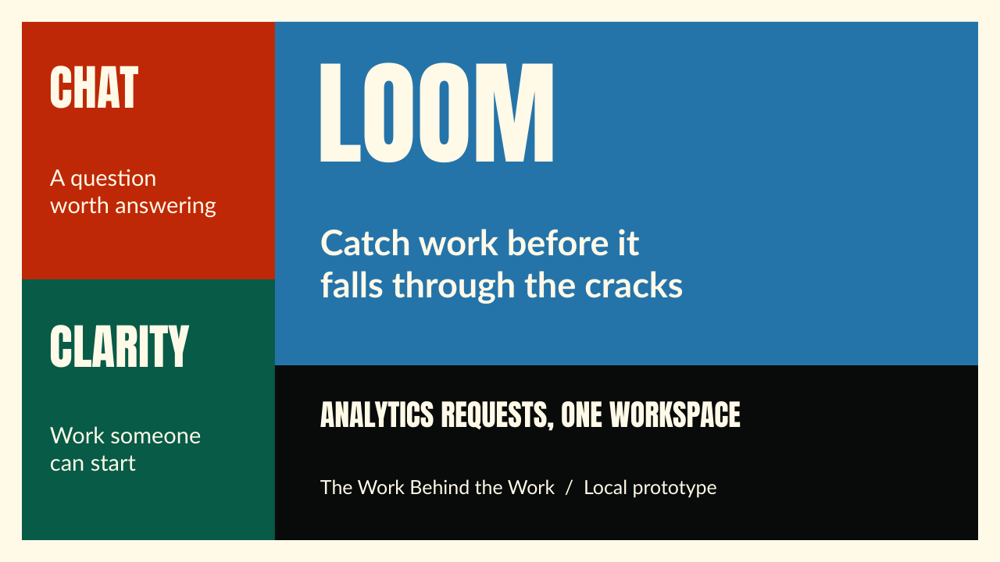

# Loom pitch deck

An 11-slide presentation covering the problem, audience, synthetic sales-request scenario, workflow, Exasol insights, Knowledge, architecture, implemented scope, and evaluation plan.

- [Presentation PDF](loom-pitch.pdf)
- [Editable PowerPoint](loom-pitch.pptx)
- [Three-minute demo script](../demo/README.md)
- [Detailed Mermaid architecture](../architecture/README.md)

## Editing

Open the PowerPoint in PowerPoint or LibreOffice Impress. Text and shapes are editable. Install **Anton** and **Lato** for the intended appearance; use the PDF when sharing a fixed layout. Speaker notes contain presentation guidance and source references.

The visual style follows the supplied reference: cream background, black heading bars, blue/red/green blocks, Anton headings, and Lato body text. The reference's country-analysis content is not reused.

The deck uses a synthetic scenario and makes no measured productivity, revenue, customer, or business-analysis claims. The [demo video](../demo/README.md) is linked from the root README and demo guide.

## Export verification

The PPTX passed package, geometry, font-family, and first-party import checks. The PDF was exported through LibreOffice and all 11 pages were visually reviewed. Native Microsoft PowerPoint rendering was not tested.
